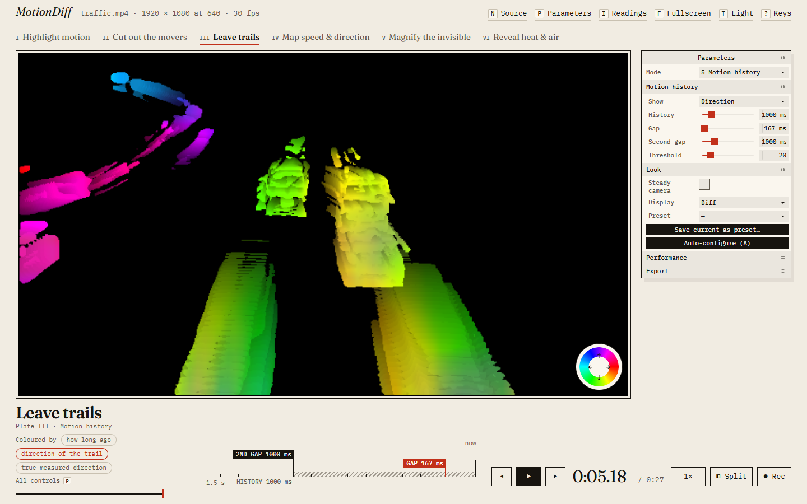

# MotionDiff

See what moves. MotionDiff is a web page that takes a video (a file, a web
address, or your camera) and shows only the motion in it, six different
ways, as it plays. The video never leaves your browser.

**[Open the demo](https://j-houghton.github.io/MotionDiff/)** ·
**[Read the documentation](https://j-houghton.github.io/MotionDiff/docs/)**



## The six effects

| Key | Effect | What you see |
|---|---|---|
| 1 | [Highlight motion](docs/concepts/highlight.md) | Whatever moves, painted over the scene |
| 2 | [Cut out the movers](docs/concepts/cutout.md) | Only the moving things, in their own colours, on black. Optionally boxed, numbered and counted |
| 3 | [Leave trails](docs/concepts/trails.md) | A band along each mover's path, coloured by time or by heading |
| 4 | [Map speed & direction](docs/concepts/speed.md) | How fast and which way each part of the picture moves, as flowing traces, arrows or colour |
| 5 | [Magnify the invisible](docs/concepts/magnify.md) | Breathing, a pulse, a sway: small slow changes made visible |
| 6 | [Reveal heat & air](docs/concepts/heat.md) | Hot air and gas, filmed against a detailed background |

## Documentation

The documentation is the markdown in [docs/](docs/index.md), published with
the demo:

- **Concepts**: [what motion extraction is](docs/concepts/motion-extraction.md),
  and a page for each effect with what its picture does and does not mean.
- **Using the demo**: [getting started](docs/guide/getting-started.md),
  [controls and keys](docs/guide/controls.md),
  [recipes](docs/guide/recipes.md),
  [counting and export](docs/guide/counting-and-export.md),
  [experimental model options](docs/guide/experimental-models.md),
  [troubleshooting](docs/guide/troubleshooting.md).
- **Technical**: [how it is built](docs/technical/architecture.md),
  [how the modes work](docs/technical/how-the-modes-work.md),
  [developing](docs/technical/developing.md).

The project is paused at version 1.0; see the [roadmap](ROADMAP.md). Design
notes and the record of what was measured are in [records/](records/README.md).

## Run it locally

```bash
git clone https://github.com/J-Houghton/MotionDiff.git
cd MotionDiff
npm install
npm run dev     # http://localhost:5173/MotionDiff/
```

`npm test` runs the unit tests. `npm run build` builds the demo and the
documentation site into `dist/`.

Tested in Chrome on a desktop GPU and on a phone. Firefox and Safari are
untested.

## Licence

[MIT](LICENSE) for the code.

- The bundled fonts (Fraunces, IBM Plex Mono, Barlow Condensed) are under
  the SIL Open Font License 1.1.
- Sample and reference clips are loaded from their original hosts and are
  not part of this repository: Pexels (Pexels licence), and for the candle
  plume JPaonaskar/Background-Oriented-Schlieren (MIT licence).
- Magnify implements a published method covered by patents held by the
  Massachusetts Institute of Technology. See
  [the note](docs/technical/how-the-modes-work.md#magnify) before using
  that mode commercially.
