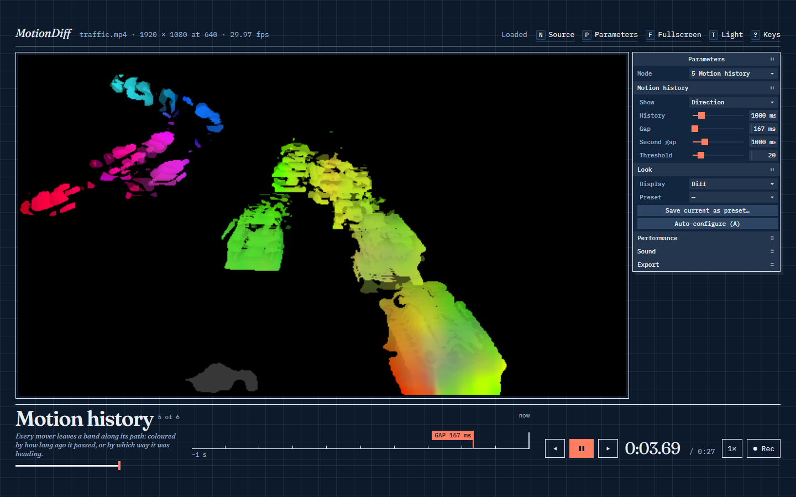
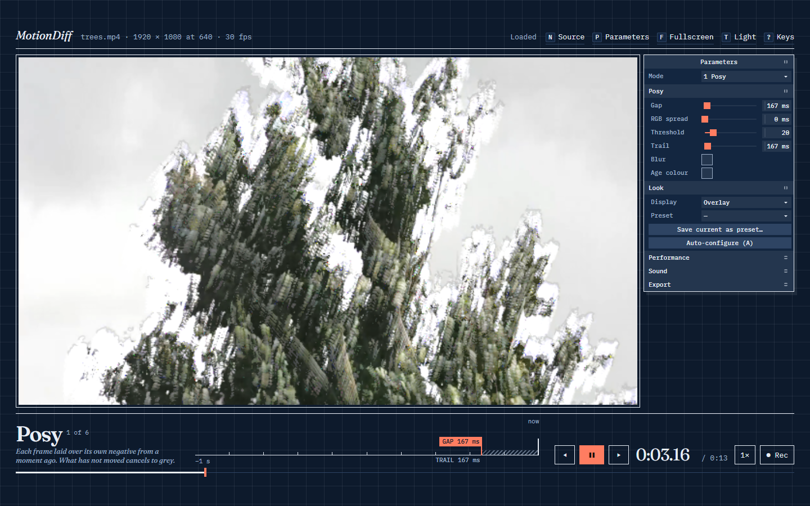
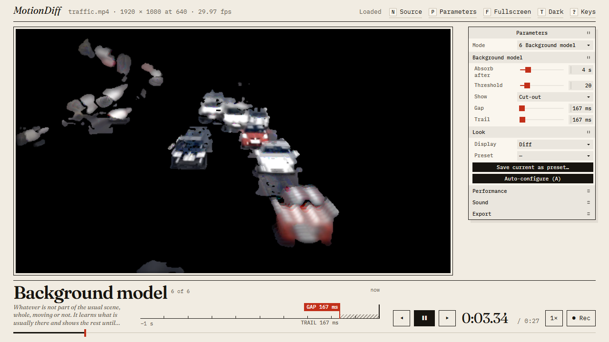
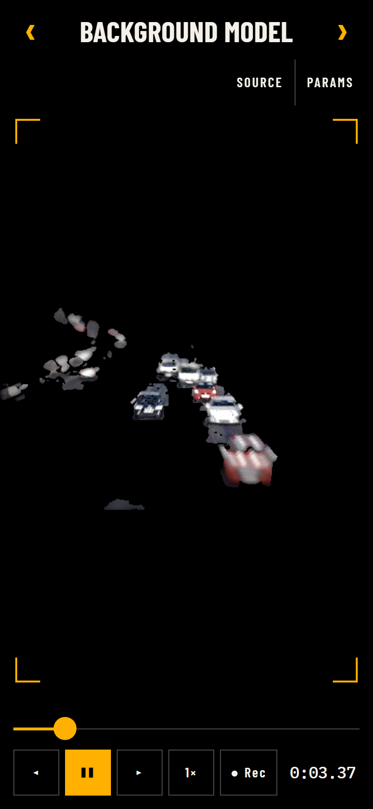

# MotionDiff

See what moves. MotionDiff is a browser tool that takes a video (a file, a URL, your camera or your screen) and shows only the motion in it, six different ways, in real time on the GPU.

**[Open the live demo](https://j-houghton.github.io/MotionDiff/)** · no install, and the video never leaves your browser.



## Modes

| Key | Mode | What you see |
|---|---|---|
| 1 | **Posy** | Each frame laid over its own negative from a moment ago. Stillness cancels to grey; motion glows, with colour fringes that show direction when the RGB channels look back by different amounts |
| 2 | **Raw diff** | The plain difference between now and a moment ago. Stillness is black; every mover appears twice, where it is and where it was |
| 3 | **Magnify** | Slow, small changes amplified until they are visible: a pulse in a face, breathing, a building swaying |
| 4 | **Motion mask** | Whatever is moving, cut out once, where it is now, in its own colours |
| 5 | **Motion history** | A band along each mover's path, coloured by how long ago it passed, or by which way it was heading |
| 6 | **Background model** | Whatever is not part of the usual scene, whole, whether it is moving or has stopped |
| 7 | **Optical flow** | How fast and which way each patch of the picture is moving: as flowing particle traces in the manner of a wind map, or as colour |
| 8 | **Schlieren** | Hot air and gas made visible. Film a candle or a heater against a detailed background with a still camera: the plume appears where the video shows nothing |

|  |  |  |
|---|---|---|
| Posy, dark theme | Background model | Viewfinder layout on a phone |

How each mode works, and what its controls mean, is in **[docs/modes.md](docs/modes.md)**.

## Using it

1. Open a video file, paste a video or HLS URL, or choose the camera or the screen. There are sample clips to start from: three plain ones, and one for each mode that opens in that mode with fitting settings (a real candle plume for Schlieren, a motorway for Optical flow, and so on).
2. Pick a mode (keys **1** to **6**) and press **A** to let MotionDiff measure the clip and set the gap and threshold for you.
3. Adjust from there in the parameter panel (**P**), or drag the markers on the time ruler under the picture.

A few more keys: **Space** play and pause, **← →** step a frame, **S** split the picture against the original, **D** cycle the display (diff, overlay, glow, data), **F** fullscreen viewfinder, **T** light and dark, **R** record the output as WebM, **?** the full list.

On a phone or tablet the picture fills the screen and the controls are small plates that fade while you watch; tap the picture to bring them back.

Recipes for particular kinds of footage are in [docs/examples/examples.md](docs/examples/examples.md), and advice on choosing the gap, threshold and trail in [docs/examples/parameter-guide.md](docs/examples/parameter-guide.md).

## Run it locally

```bash
git clone https://github.com/J-Houghton/MotionDiff.git
cd MotionDiff
npm install
npm run dev     # http://localhost:5173/MotionDiff/
```

`npm test` runs the unit tests and `npm run build` makes the production build.

## Browser support

MotionDiff uses WebGL2 where it is available and falls back to a Canvas 2D worker where it is not. Posy, Raw diff and Magnify run on both; the motion mask needs WebGL2, and motion history and the background model also need float render targets. A mode that cannot run on your device says so instead of showing a blank picture.

It has been developed and tested in Chrome on desktop. Other browsers and real phones are not yet tested.

## Documentation

| | |
|---|---|
| [docs/modes.md](docs/modes.md) | How each mode works and what every control does |
| [docs/examples/](docs/examples/) | Settings for common footage, and how to choose them |
| [docs/development.md](docs/development.md) | Project layout, conventions, tests, how changes are checked |
| [ROADMAP.md](ROADMAP.md) | What is done, what is next, what is deferred and why |
| [docs/verdicts.md](docs/verdicts.md) | What each visual change was expected to do, and what was measured |
| [docs/research.md](docs/research.md) | What other implementations do, and which ideas were adopted |
| [docs/optical-flow.md](docs/optical-flow.md) | Optical flow: the method and how it was built |
| [docs/particles.md](docs/particles.md) | Particle traces: what the picture means, and what it does not |
| [docs/schlieren.md](docs/schlieren.md) | Schlieren: how to film it, what it shows, what was and was not checked |
| [scripts/README.md](scripts/README.md) | Dev tooling: reference clips, filmstrips, checks against known motion |

## Licence

[MIT](LICENSE) for the code.

- The bundled fonts (Fraunces, IBM Plex Mono, Barlow Condensed) are not MIT: each is under the SIL Open Font License 1.1.
- Sample and reference clips are loaded from their original hosts and are not part of this repository: Pexels (Pexels licence), and for the candle plume JPaonaskar/Background-Oriented-Schlieren on GitHub (MIT licence).
- Magnify implements a published method that is covered by patents held by the Massachusetts Institute of Technology. This is a personal, non-commercial project; see [the note in docs/modes.md](docs/modes.md#magnify) before using that mode commercially.
