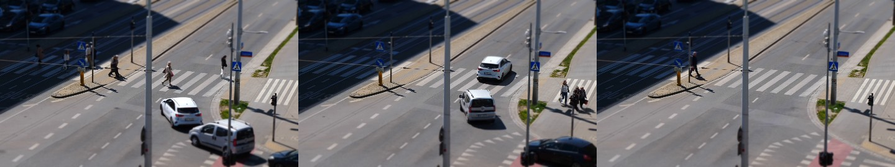
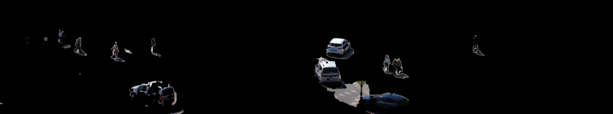
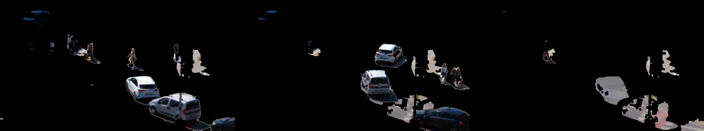

# Cut out the movers

**Only what moves stays in the picture; the rest goes black.** Each mover is
shown once, where it is now, in its own colours.

In the demo it is the second effect: press **2**.

## What you see

Three moments, two seconds apart, at a road junction seen from above:

With *Things that stop* set to **vanish at once**. The walkers and the moving
cars are cut out. The two cars waiting in the first frame are mostly missing,
because they are barely moving:

With **fade out slowly**. The waiting cars are whole. In the last frame a
patch of empty road is drawn where they stood: they had waited long enough
to count as part of the scene, so the road they uncovered looks new.

## The choices under the picture

| Choice | Options |
|---|---|
| **Things that stop** | *vanish at once* marks only what is moving now. *fade out slowly* learns what the scene usually looks like and shows anything that differs, moving or not. A thing that stops stays in the picture until it has been still for the **Absorb after** time (in the parameter panel), then joins the scenery |
| **Holes** | *filled in* closes small gaps inside each cut-out |
| **Movers** | *boxed & numbered* draws a box round each mover with a number that stays with it, its speed, and an arrow to where it will be in one second. A small box gets only the box and the arrow. Boxes can be [counted and exported](../guide/counting-and-export.md) |

## What the picture means, and what it does not

**A measurement:**

- *What is cut out.* A point is kept when it differs from the picture at two
  earlier moments, which is why a mover is not drawn a second time where it
  used to be.
- *A box's speed.* It is how far the box moved, in pixels of the picture per
  second.

**An estimate:**

- *The arrow on a box* assumes the mover carries on as it is going.
- Names and depth-corrected speeds, if you switch on the
  [experimental model options](../guide/experimental-models.md), are marked
  **≈**.

**Known limits:**

- A plain object shows only its leading edge unless *fade out slowly* is on.
- A slow or large mover can leave part of a ghost behind it. Lengthen the
  **Second gap** in the parameter panel: it is the older of the two moments
  each picture is compared with.
- With *fade out slowly*, whatever is in view when the video starts is taken
  as scenery and leaves a ghost when it moves off. Leaves and water, which
  never stop, stay marked. A change of lighting marks everything until it
  has been absorbed.
- A box is not always one object. Two movers that touch share a box, and one
  plain mover can briefly carry two.

## Try it

- Choose **Watch it on Bees at the Hive**. *Crossing from Above* is the clip
  pictured here.
- *vanish at once* needs WebGL2. *fade out slowly* also needs float render
  targets. See [Troubleshooting](../guide/troubleshooting.md).
