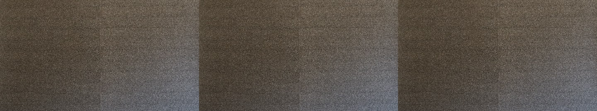
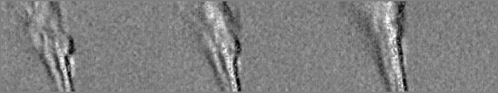

# Reveal heat & air

**Hot air and gas appear where the video shows nothing.** Hot air bends
light a little. Seen through it, a detailed background shifts by a fraction
of a pixel. The app measures that shift and draws it.

In the demo it is the sixth effect: press **6**. The technique is called
background-oriented schlieren.

## What you see

A candle plume in front of a sheet of printed dots. The flame is below the
picture, and in the video there is nothing to see:

This look is **knife edge**, named after the classic way of photographing
hot air: light where the background is pushed one way, dark where it is
pushed the other. Even grey grain means "measuring, and no
hot air here". Under *Shown as* there are also **strength** (how big the
shift is) and **direction** (which way).

## What the picture means, and what it does not

**A measurement:**

- *How far the background appears to shift*, in pixels, at each point.

**What that tells you:**

- Where the air is unevenly hot, or where a gas of a different density is
  mixing in. It is not a temperature and not a speed.

**Known limits:**

- Nothing is drawn where the background is plain.
- Flickering lamps, a camera adjusting exposure and a camera refocusing all
  read as signal.
- Video compression smooths away the smallest shifts.
- By default the app compares against the recent past, so a plume that
  holds steady fades from the picture. See *Hold reference* below.
- This effect has been confirmed on recorded clips only, not yet on a live
  camera.

## Filming for it

| You need | Why |
|---|---|
| A detailed background: print [this dot pattern](../../public/schlieren-pattern.svg), or use brick, gravel, foliage or a bookshelf | A shift can only be measured against detail |
| The camera propped so it cannot move | The shifts are about a tenth of a pixel. A hand moves the picture by many pixels |
| The hot air well in front of the background, about a metre | The shift grows with that distance |
| Focus and exposure locked, steady light | Otherwise the camera's own adjustments show up |
| Not a screen showing a fine pattern | Screens flicker and fine regular patterns shimmer |

Record a clip this way and open the file, or pick the effect and choose
**Camera** to try it live. Only recorded clips are confirmed to work. In a
recording, start filming before the candle is lit.

Then, in the parameter panel (key **P**):

- Set *Show* to **Setup check**, a fourth look that only the panel lists.
  Whatever cannot be measured is hatched in red.
- Read the status line at the top. `69% measurable · shifts over 0.08 px show` is a
  good setup. It also says when the background is too plain or the camera is
  moving. If the pattern is very fine, raise **Width** under *Performance*.
- To see a steady plume: let the picture settle with nothing hot in view,
  switch on **Hold reference**, then light the candle.

## Try it

- Choose **Watch it on Candle Plume**.
- This effect needs WebGL2 and float render targets. See
  [Troubleshooting](../guide/troubleshooting.md).
