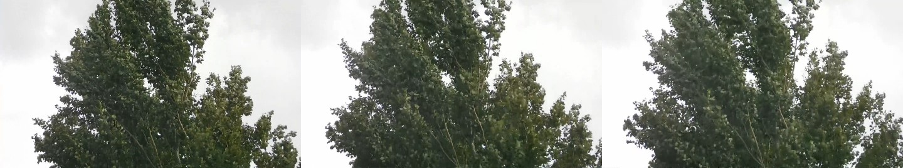
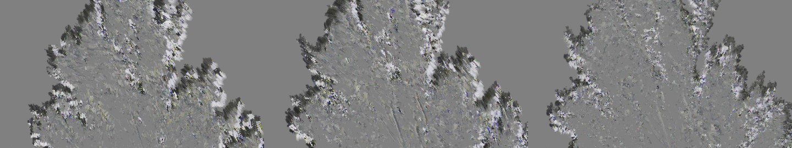

# Highlight motion

**Whatever moves is painted over the scene; stillness fades to nothing.**
This is the plainest effect: each picture compared with one from a moment
ago.

In the demo it is the first effect: press **1**.

## What you see

Grey is stillness. Brightness is not speed: a strong mark means the mover
and what is behind it differ a lot in brightness.

Under the picture, *Drawn as* offers two looks.

| Choice | What it does |
|---|---|
| **ghostly colour** | Lays each picture over the negative of an earlier one. Still areas cancel to flat grey. A moving edge shows light where something brighter arrived and dark where it left. This is the picture above |
| **bare difference** | Shows the size of the change and nothing else: black for stillness, brighter for a bigger change. The picture on [the overview page](motion-extraction.md) uses it |

## What the picture means, and what it does not

**A measurement:**

- *Where the picture changed*, and by how much, between now and one gap ago.

**An estimate:**

- *Direction from colour fringes.* With **RGB spread** above zero in the
  parameter panel, red, green and blue each look back a different amount, so
  a moving edge gets a warm side and a cool side. That hints at which way it
  went, but it depends on the colours in the scene. For a real heading use
  [Leave trails](trails.md) or [Map speed & direction](speed.md).

**Known limits:**

- A plain object shows only at its edges: where it arrived and where it left.
- In *bare difference* every mover appears twice, once where it is and once
  where it was one gap ago.
- With a long gap a small, fast object shows as two separate copies.
- Something that stops moving disappears.

## Try it

- Choose **Watch it on Trees in Wind** on the demo's opening page. *Flowing
  River* and *Flower Opening* also suit it.
- **Gap** and **Trail** are markers on the time ruler under the picture;
  drag them. *Trail* keeps each mark on screen for a while after the
  movement, which turns motion into streaks. **Threshold** is in the
  parameter panel (key **P**), or use the keys **-** and **=**.
- This effect runs in every browser the demo runs in.
