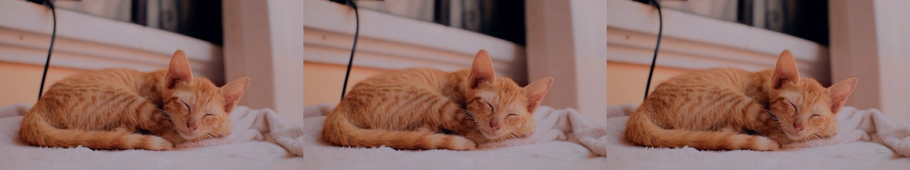
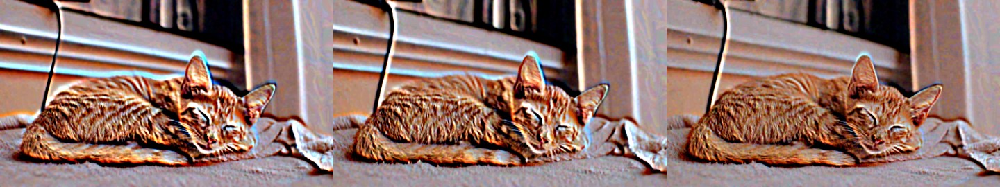

# Magnify the invisible

**Breathing, pulse, sway: small, slow movements amplified until you can see
them.** The app looks for changes that repeat at a chosen rate, multiplies
them, and adds them back onto the video.

In the demo it is the fifth effect: press **5**.

## What you see

A sleeping kitten, and the same moments with whatever repeats 9 to 60 times
a minute amplified 20 times:

A still picture undersells this effect. In the moving picture the kitten's
side visibly rises and falls with each breath. What a still does show is
where the change is: on the animal, and little on the wall.

Under the picture:

| Choice | Options |
|---|---|
| **Amplify** | *brightness changes* amplifies how each point's brightness rises and falls. *measured motion* measures the tiny movement itself and pushes the picture further the same way |
| **Still areas** | *muted* learns how much each point normally flickers and stops amplifying places where nothing ever happens. It can also mute a real signal that is fainter than the flicker |

Three sliders in the parameter panel (key **P**) set the rest. **Amplify**
is how many times over.
**Band low** and **Band high** are the slowest and fastest rates to look
for, in hertz (cycles a second). The caption under the picture turns them
into "times a minute"; a resting pulse is 50 to 90 and breathing 12 to 20.

## What the picture means, and what it does not

**A measurement:**

- *Where something repeats* at a rate inside the band.

**Not a measurement:**

- *How much it moves.* The size is exaggerated by the amount you set.
- *How often.* The picture shows that a rhythm falls inside the band, not
  its rate.

**Known limits:**

- The camera has to be still, on a tripod or propped. Any shake is amplified
  with everything else.
- The camera's flicker is amplified too. **Pool** in the parameter panel
  (2x, 4x) trades detail for less of it.
- A camera adjusting its exposure looks like a pulse. Lock the exposure if
  you can.
- It takes about a second to settle after the video starts or jumps.
- Edges get bright and dark halos, as in the picture above.

## Try it

- Choose **Watch it on Sleeping Kitten**.
- This effect needs WebGL2 and float render targets. Without WebGL2, only
  *brightness changes* works. See
  [Troubleshooting](../guide/troubleshooting.md).
