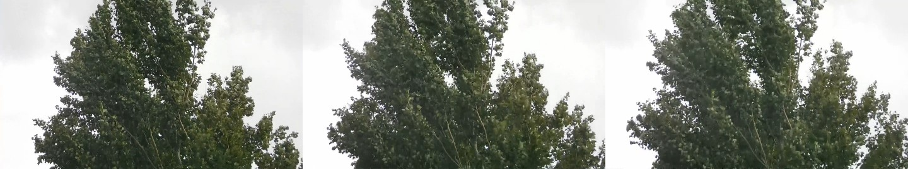
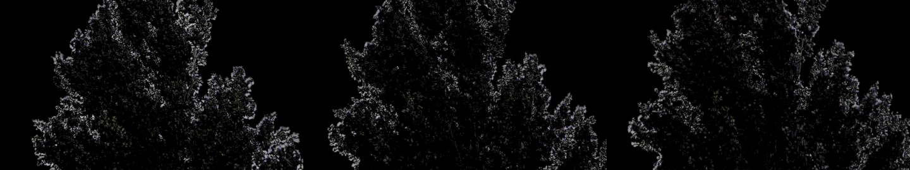

# What motion extraction is

A video is a row of still pictures. Motion extraction compares each picture
with one from a moment earlier and keeps only the difference. Whatever stayed
the same cancels out. Whatever changed remains.

Three moments of trees in wind, and the same moments with each picture
compared against the one 67 milliseconds before it:

The sky and the trunk did not change, so they are black. The leaves moved, so
their edges are bright.

## Two settings behind every effect

- **Gap** is how far back the comparison picture is. A short gap catches fast
  things. Slow things, like drifting cloud, need a long gap, because they
  have to travel far enough between the two pictures to register.
- **Threshold** is how big a change has to be to count. A camera's picture
  flickers slightly even when nothing moves, and the threshold hides anything
  smaller than that flicker.

The demo can choose both for you: press **A**. Settings for particular kinds
of footage are in [Recipes](../guide/recipes.md).

## The six effects

| Effect | What it shows |
|---|---|
| [Highlight motion](highlight.md) | Whatever moves, painted over the scene |
| [Cut out the movers](cutout.md) | Only the moving things, in their own colours, on black |
| [Leave trails](trails.md) | A band along the path of each mover |
| [Map speed & direction](speed.md) | How fast and which way each part of the picture moves |
| [Magnify the invisible](magnify.md) | Small, slow changes such as breathing, made large enough to see |
| [Reveal heat & air](heat.md) | Hot air and gas, which the video itself does not show |

## Reading a picture

Each effect page sorts what its picture tells you into three kinds.

- **A measurement** is worked out directly from the video: where the picture
  changed, or how far a patch moved between two frames. The same video always
  gives the same answer.
- **An estimate** is inferred from measurements, or comes from a model. A
  heading read from the shape of a trail is an estimate. So is a name a model
  gives to a moving thing. The demo marks estimates with **≈**.
- **A known limit** is a situation where the picture is wrong or empty for a
  reason that is understood.

Four limits apply to every effect:

- **The camera has to stay still.** If the camera moves, the whole scene
  changes and everything counts as moving. For a shake or a slow drift,
  most effects have *Steady camera* in the parameter panel (key **P**).
- **Plain surfaces show nothing.** A change can only be seen where there is
  detail. A flat-coloured object registers at its edges and not inside.
- **A change is not always movement.** A shadow, a reflection, or the camera
  adjusting its exposure changes the picture like a moving object does.
- **Empty means "not measured".** A black area had no change larger than the
  threshold. Something slow or faint may still be there.

Speeds are in pixels of the picture per second until you
[calibrate](../guide/counting-and-export.md#real-units-calibration).
