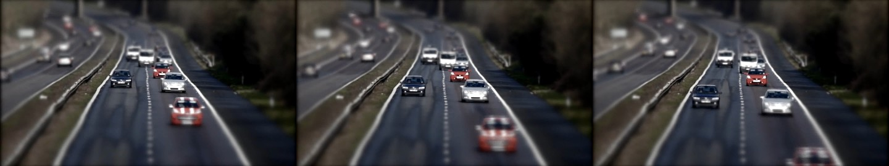
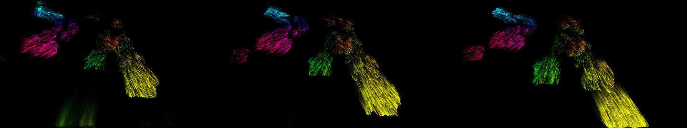
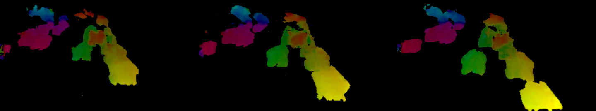

# Map speed & direction

**A wind map of the picture: how fast, and which way, every patch moves.**
The app follows small patches of the picture from one frame to the next and
draws where each one went.

In the demo it is the fourth effect: press **4**.

## What you see

Drawn as **flowing traces**. Each line is the path a point of the picture
followed. Colour is the heading, the same compass as in
[Leave trails](trails.md): yellow-green is down the picture, magenta and blue
are up and to the left.

Drawn as **colour**. Hue is the heading and brightness is the speed:

The third look, **arrows**, puts an arrow at each point of a fixed grid. It
points the way that patch moves, and its length is the speed.

*Measured on* limits the map: **everything**, **only the movers**, or
**except the background** (which keeps a mover on the map for a while after
it stops).

## What the picture means, and what it does not

**A measurement:**

- *The direction of a trace*, an arrow or a hue.
- *The length of a trace*: how far that point travelled while the trace was
  on screen. *The length of an arrow*: the speed, where full length is the
  **Speed range** setting.
- *Brightness*: faster is brighter, up to the speed range.

**Not a measurement:**

- *Where a trace starts* is random.
- *How many traces* are in a place means nothing. Traces gather wherever
  something is measured, so "some" and "none" tell you something, and
  "many" does not.

**Known limits:**

- Nothing is measured on a plain surface. A plain object carries traces only
  at its edges and markings. An area with no traces is either still or
  unmeasurable.
- Along a straight edge, only movement across the edge can be seen.
- Each **Gap** setting can follow movement up to a certain speed. Faster
  than that, the answer is wrong, not just weak, and the status line asks
  you to shorten the gap. Use a short gap for fast things and a long one for
  slow things.
- An arrow between two movers shows their average. Small, slow movers can
  fall between arrows.
- If the camera moves, everything flows.

## Try it

- Choose **Watch it on Motorway**. *Weir* and *Clouds over Peaks* also suit
  it.
- The readings column beside the picture (key **I**) shows the fastest speed,
  the spread of headings, and how much the camera itself is moving.
- This effect needs WebGL2 and float render targets. See
  [Troubleshooting](../guide/troubleshooting.md).
