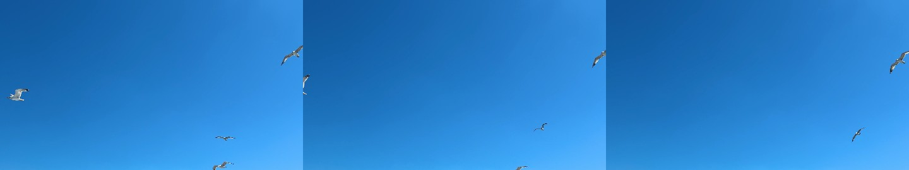
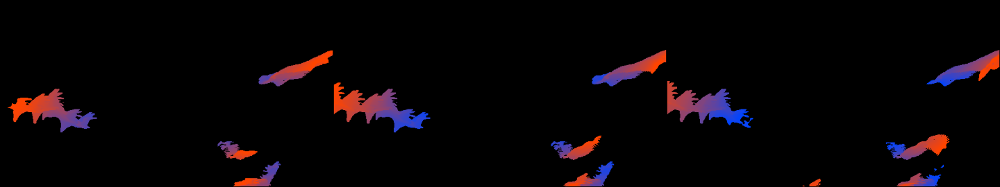
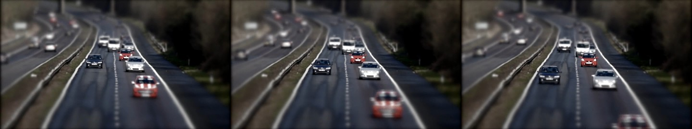
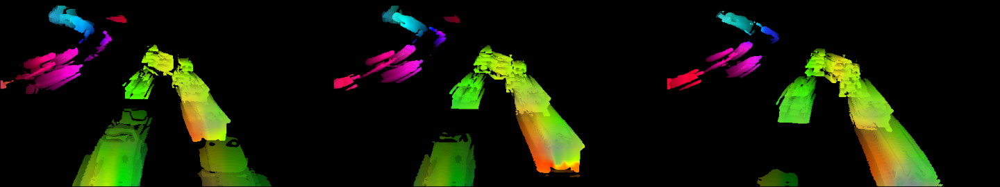
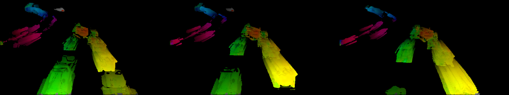

# Leave trails

**Every mover leaves a band along its path.** The band can be coloured by how
long ago the mover passed, or by which way it was heading.

In the demo this is the third effect: press **3**, or pick *Leave trails* from
the row of effects above the picture.

## What you see

Three moments from a clip of gulls against a clear sky, and the same three
moments with trails on:

Everything that stayed still is black. Each gull has left a band behind it.
The band is orange where the bird is now and slides to blue where it was a
couple of seconds ago, so one still picture shows where each bird has been and
in what order.

## Three ways to colour the band

Under the picture, *Coloured by* offers three choices.

| Choice | What the colour tells you |
|---|---|
| **how long ago** | The time since something last moved at that spot. The newest part of a band has one colour, the oldest another, with a smooth slide between them |
| **direction of the trail** | Which way the mover was heading, read from the shape of the band itself |
| **true measured direction** | Which way, and how fast, the mover was going when it laid that part of the band down, taken from a separate measurement of movement between two frames |

In the two direction views the colour is a compass. A small colour wheel
appears in the corner of the picture as a reminder:

| Colour | Heading |
|---|---|
| red | to the right |
| yellow-green | down |
| cyan | to the left |
| violet | up |

Grey means no heading: in *direction of the trail* the patch does not agree
on one, and in *true measured direction* nothing could be measured there.

Traffic on a motorway, coloured by the direction of the trail. The near
lanes come towards the camera, down the picture, and read yellow-green. The
far lanes run the other way and read blue to magenta:

The same moments with *true measured direction*. The hues agree, and here
(unlike the other two views) brightness is speed: the fast near lane is
bright, the slow distant traffic is dim.

## What the picture means, and what it does not

**A measurement:**

- *Where the band is.* The band covers the places where the picture changed
  within the history length you set. Where there is no band, nothing moved in
  that time, or it moved too little to pass the threshold.
- *How long ago.* The colour in the first view is the measured time since the
  last change at that spot.
- *True measured direction.* Heading and speed come from comparing two frames
  a moment apart, patch by patch.

**An estimate:**

- *Direction of the trail.* This view never measures a heading directly. It
  works it out from the band: behind a mover the band gets steadily older, so
  the mover must be travelling away from the old end. That reasoning is only
  right on average, so the app averages it over patches about 56 pixels
  across.

**Known limits:**

- A band wider than about 56 pixels can show different hues along its two
  edges in the *direction of the trail* view. The orange patches low on the
  near lane above are an example.
- Things that sway back and forth, such as leaves or water, give mixed or
  grey colours. Grey means the patch does not agree on one heading.
- A plain, flat-coloured object only registers at its edges, so the object
  itself can look hollow or uneven. The band behind it is still drawn.
- In *true measured direction*, grey means nothing could be measured there.
  The inside of a flat-coloured mover keeps the last colour measured on it.
- The camera has to stay still. If the camera moves, the whole scene moves,
  and everything leaves a trail.
- A band shows that something changed, not what it was. A shadow or a
  reflection sweeping across the scene leaves a band like any object.

## Try it

- Open the demo and choose **Watch it on Gulls Overhead** under *Leave
  trails*. *Crossing from Above* is also good.
- **History** sets how far back the band reaches: drag its marker on the
  time ruler under the picture. (The separate *Trail* setting belongs to
  other effects.)
- **Threshold**, in the parameter panel (key **P**), sets how big a change
  counts as movement. Raise it if still areas sparkle; lower it if slow
  movers leave gaps.
- This effect needs WebGL2 and float render targets. Where it cannot run,
  the app says so instead of showing a blank picture. See
  [Troubleshooting](../guide/troubleshooting.md).

Related: [Cut out the movers](cutout.md) uses the same test for "what moved"
and shows only the mover, with no band. [Map speed & direction](speed.md)
shows the measured movement on its own.
