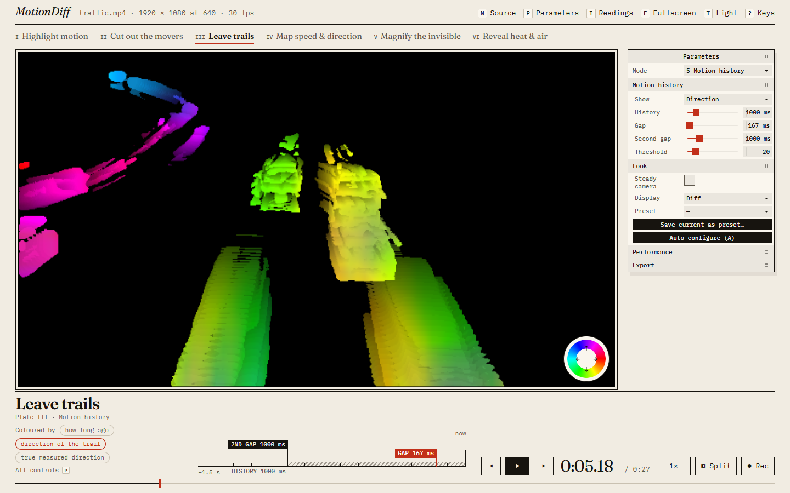

# Controls and keys

The screen, from the top: the video's name and size, then the **status
line**, where the demo's messages appear, then the buttons. Below them the
row of effects, the picture, and the controls described here.

## Under the picture

- **The effect's choices.** Each effect has one to three rows of choices,
  explained on [its own page](../concepts/motion-extraction.md#the-six-effects).
  *All controls* opens the parameter panel.
- **The time ruler.** "Now" is at the right and the past runs to the left.
  The markers show how far back the app is comparing (**GAP**, and in some
  effects **2ND GAP**) and how long marks stay on screen (**TRAIL**, or
  **HISTORY** in *Leave trails*). Drag a marker to change it. Effects with
  no gap show a sentence about their settings here.
- **Play controls.** Step back, play or pause, step forward, the time, the
  playback speed (0.25× to 2×), **Split** and **● Rec**. The bar along the
  bottom moves through the video.

## Ways of looking

| Control | What it does |
|---|---|
| **Display** (key **D**) | Steps through four ways to draw the effect: *diff* is the effect on its own, *overlay* lays it over the video, *glow* adds it to the video as light, and *data* shows the measured values themselves. Not used by *Magnify the invisible* |
| **Split** (key **S**) | Puts the original on the left of a line and the effect on the right. Drag the line |
| Hold **O** | Shows the original for as long as the key is down |
| **Auto-configure** (key **A**) | Measures the video's flicker and sets the gap and threshold just above it |
| **F** | Full screen, in the layout phones use |
| **H** | Hides everything but the picture |
| **T** | Switches between the light and dark themes |

## The parameter panel

Press **P**. The panel holds every setting, in folders:

- **Mode.** The six effects are built from eight modes, and the panel and
  the demo's messages use the mode names. Picking a choice under the
  picture switches mode for you; this list picks one directly.
  [How the modes work](../technical/how-the-modes-work.md) describes each.

  | Effect | Modes |
  |---|---|
  | Highlight motion | Posy (*ghostly colour*), Raw diff (*bare difference*) |
  | Cut out the movers | Motion mask (*vanish at once*), Background model (*fade out slowly*) |
  | Leave trails | Motion history |
  | Map speed & direction | Optical flow |
  | Magnify the invisible | Magnify |
  | Reveal heat & air | Schlieren |

- **The mode's own settings**, such as *Gap*, *Threshold* and *Trail*.
- **Look.** *Steady camera* cancels the camera's own movement (not offered
  in *Magnify the invisible* or *Reveal heat & air*). *Preset*
  loads a saved set of settings, and *Save current as preset…* stores yours
  in this browser.
- **Performance.** *Width* is how wide the picture is while it is being
  processed, from 320 to 1920 pixels. Lower it if the picture stutters;
  raise it for fine detail. *Frame cap* limits the frame rate.
- **Export.** Recording and data files: see
  [Counting and export](counting-and-export.md).

## The readings column

Press **I** on a computer. Beside the picture the app shows what it is
measuring: how much of the picture is moving over the last minute, and in
*Map speed & direction* the fastest speed, the spread of headings and the
camera's own movement. *All readings* lists every number. The column also
has the links for [calibrating and counting](counting-and-export.md).

## Keys

| Key | What it does |
|---|---|
| **Space** or **K** | Play or pause |
| **←** **→** | Step one frame |
| **J** **L** | Slower, faster |
| **1** to **6** | Pick an effect |
| **[** **]** | Gap shorter, longer |
| **-** **=** | Threshold lower, higher |
| **,** **.** | Trail shorter, longer (*Highlight motion*, *Cut out the movers*) |
| **D** **S** **O** **A** **F** **H** **T** | As in the table above |
| **P** | Parameter panel |
| **I** | Readings column |
| **C** | Calibrate: mark a known length |
| **X** | Count line |
| **N** | Choose a video |
| **R** | Record, stop recording |
| **?** | Show this list in the demo |
| **Esc** | Close whatever is open |
