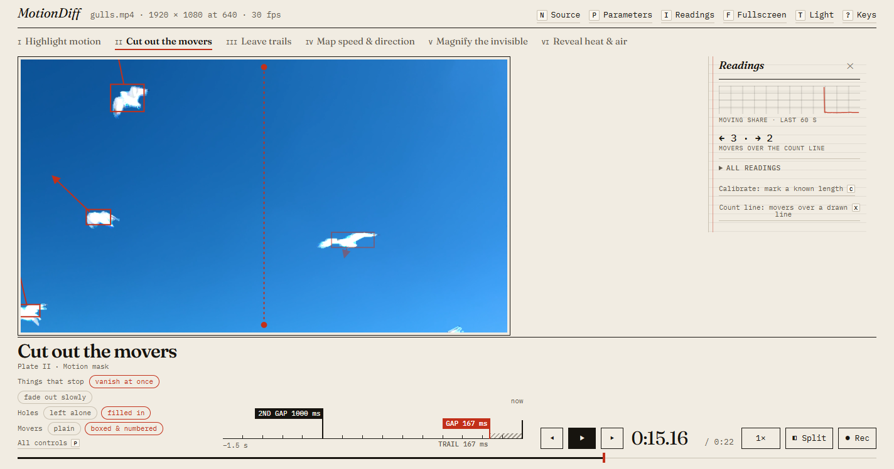

# Counting and export

The demo can put a box round each mover, count the boxes that cross a line
you draw, turn speeds into real units, and save what it measured as files.

Counting and calibration work on a computer only: they need the keyboard
or the readings column, and phones have neither.

## Count movers crossing a line

Example: how many gulls fly across the middle of the picture, each way.

1. **Load footage from a still camera.** Here, the *Gulls Overhead* sample.
2. **Choose _Cut out the movers_** (key **2**).
3. Under the picture, set **Movers** to **boxed & numbered**.
4. **Press X**, or use *Count line: movers over a drawn line* in the
   readings column. The status line reads *Count line: click both ends of
   the line movers should cross*.
5. **Click two points** to draw the line across the movers' path.
6. **Read the count** in the readings column (key **I**), under *movers
   over the count line*: two numbers, each with an arrow for the direction
   of crossing.

In this run the line went up 1.5 seconds into the clip and stayed for 14
seconds, with *Holes: filled in* and the display set to overlay (key **D**).
The demo counted 3 gulls leftwards and 2 rightwards. Counting by eye from
the same footage, five frames a second, gives the same five crossings at
the same moments.

For cars the steps are the same. Draw the line across one direction of
travel, at a place where the vehicles are well apart.

Press **X** again to clear the line and its counts. **Esc** cancels a line
you have started. Loading another video also clears it.

### What is counted

- A crossing is counted when the **centre of a box** moves from one side of
  the line to the other, between the line's two ends.
- A box that crosses and comes back counts once each way.
- A box that first appears already past the line is not counted.

### How far to trust the count

The count is of **boxes**, and a box is not always one object. It is exact
when movers stay apart, as the gulls do. It goes wrong when they crowd:

- Two movers that touch share one box and count **once**.
- One plain-coloured mover can briefly carry two boxes and count **twice**.
- A box that disappears before the line is never counted.
- **A known failure:** on the *Motorway* sample, with a line across the near
  carriageway and *Holes: filled in*, nine seconds gave 18 crossings down
  the picture and 2 up, on a road where nothing travels up. Boxes on packed
  traffic merge and split, and their centres jump back over the line.

Treat a count on busy footage as an estimate and check it against the video.
Two choices are worth trying, though neither cures packed traffic: **Things
that stop: fade out slowly** keeps a box on a vehicle that pauses, and
**Holes: filled in** keeps one mover in one box more often.

## Real units: calibration

Speeds are in pixels per second until you tell the demo how big something
in the picture is.

1. Press **C**, or use *Calibrate: mark a known length* in the readings
   column.
2. Click both ends of something whose real length you know: a car, a lane
   marking, a doorway.
3. Type its length in metres and press **Set**.

From then on, speeds on the boxes and the fastest speed in the readings
column are in metres per second, and the tracks file gains a `speed_mps`
column.

The scale is true only at the distance from the camera where you marked the
length. Things further away read slower than they are, and nearer things
faster. Loading another video clears the calibration.

## Save the numbers

Open the parameter panel (key **P**) and its **Export** folder.

1. Press **Collect data**. The button changes to *Stop collecting data*.
2. Play the video. Every processed frame is added to a log.
3. Press **Export tracks (CSV)** or **Export readings (JSON)**. The browser
   saves `motiondiff-tracks-….csv` or `motiondiff-readings-….json`.

Collecting works in every effect. The tracks file needs boxes, so it only
fills in *Cut out the movers* with boxes on.

**Tracks (CSV)** has one row for each box in each frame:

| Column | Meaning |
|---|---|
| `t` | Time in the video, seconds |
| `id` | The box's number |
| `cx`, `cy` | Centre of the box, in pixels of the processed picture (x to the right, y down) |
| `w`, `h` | Width and height of the box, pixels |
| `vx`, `vy`, `speed` | Velocity and speed, pixels per second |
| `speed_mps` | Speed in metres per second, after calibration |

The processed picture's size is shown at the top beside the video's name:
`1920 × 1080 at 640` means it is processed 640 pixels wide.

**Readings (JSON)** has three parts: `meta` (the video's name, the processed
size, every setting, the calibration and count line, the version of the
app), `frames` (per frame: the time, the mode, what was measured, the
running counts) and `events` (each crossing of the count line: its time, the
box's number and its direction, `1` or `-1`).

Limits: the log holds 100,000 rows and the status line says when it is
full. Loading another video clears the log and stops collecting.

## Save the picture

Press **R**, or **● Rec** beside the play controls, to record what the
picture shows; press again to stop. The browser saves a WebM video,
`motiondiff-….webm`. Traces and arrows are part of the recording. Boxes, the
count line and the readings column are drawn over the picture and are not.
