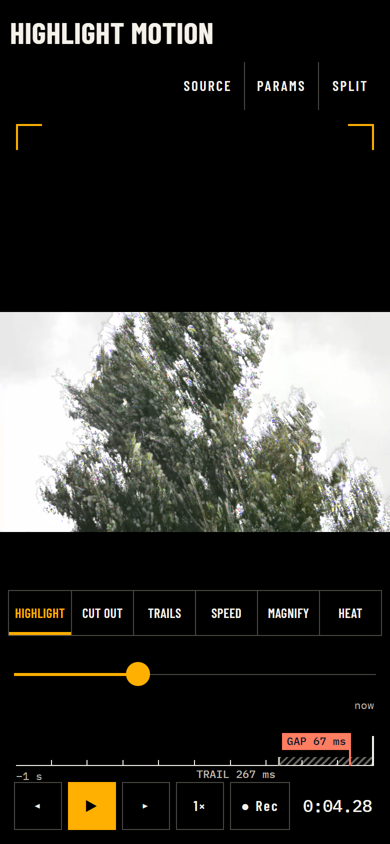

# Getting started

Open **[the demo](https://j-houghton.github.io/MotionDiff/)**. Nothing is
installed, and your video is processed in your own browser.

## Pick a video

The opening page lists the six effects. Each has a **Watch it on …** button
that opens the effect playing on a sample that suits it. To use your own
video instead:

| Source | How |
|---|---|
| A file | **Open a file…**, or drag a video file onto the page |
| A web address | Paste it into **Paste a video URL** and press **Load**. It has to be the address of a video file. YouTube pages and HLS or DASH streams are not supported |
| Your camera | **Camera**. The browser asks for permission. **⇄ Flip** switches between the front and back cameras |
| Yourself | **Mirror** opens the front camera full screen and flipped left to right, like a mirror |

Press **N**, or **Source** at the top, to change the video later. That list
also has all twelve samples.

On a camera, pinching with two fingers zooms, if the camera supports it.

If a web address belongs to a site that does not let other sites read its
video, the demo tries again through a public relay (corsproxy.io). That is
the one case where the video's address is sent anywhere.

## Pick an effect

The six effects are in a row above the picture; the keys **1** to **6** pick
them. The name, a one-line description and a few choices appear under the
picture. Each effect has [its own page](../concepts/motion-extraction.md#the-six-effects).

Press **A** to have the demo measure the video and set the gap and threshold
for you. Then adjust from [the controls](controls.md).

## On a phone

On a phone or tablet the picture fills the screen. The effects are a strip
of words; tap one to pick it, and tap it again for its choices. **Source**,
**Params** and **Split** are at the top. The controls fade while the video
plays; tap the picture to bring them back.

The same layout is available on a computer: press **F** for full screen.

Counting and the readings column are not available on a phone.
