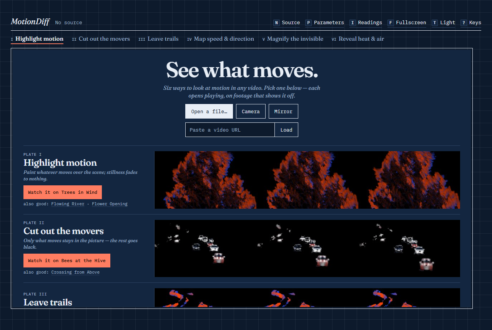

# MotionDiff

MotionDiff is a web page that takes a video and shows only what moves in it.
It works on a file, a video address or your camera, and the video never
leaves your browser.

**[Open the demo](https://j-houghton.github.io/MotionDiff/)**

## Where to start

- **New to it?** Read [What motion extraction is](concepts/motion-extraction.md),
  then the page for any of the six effects:
  [Highlight motion](concepts/highlight.md),
  [Cut out the movers](concepts/cutout.md),
  [Leave trails](concepts/trails.md),
  [Map speed & direction](concepts/speed.md),
  [Magnify the invisible](concepts/magnify.md) and
  [Reveal heat & air](concepts/heat.md).
- **Using the demo?** [Getting started](guide/getting-started.md), then
  [Controls and keys](guide/controls.md). To get numbers out, see
  [Counting and export](guide/counting-and-export.md). If something does not
  run, see [Troubleshooting](guide/troubleshooting.md).
- **Running or changing the code?** [How it is built](technical/architecture.md),
  [How the modes work](technical/how-the-modes-work.md) and
  [Developing](technical/developing.md).

## Status

The project is paused at version 1.0. Everything described here is built and
works. Two options that load a neural network are marked experimental; see
[Experimental model options](guide/experimental-models.md). Ideas for later
are in the [roadmap](../ROADMAP.md).

## Licence and credits

The code is under the [MIT licence](../LICENSE).

- The fonts (Fraunces, IBM Plex Mono, Barlow Condensed) are under the SIL
  Open Font License 1.1.
- The sample videos are loaded from their own hosts and are not part of the
  project: Pexels (Pexels licence), and for the candle the
  JPaonaskar/Background-Oriented-Schlieren project (MIT licence).
- *Magnify the invisible* uses a published method that is patented. Read
  [the note](technical/how-the-modes-work.md#magnify) before using it
  commercially.
